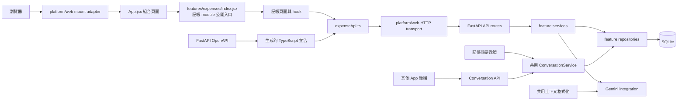

# 記帳小幫手

React + Vite 前端、FastAPI 後端與 SQLite 資料庫組成的記帳 Web App。Gemini 負責記帳分類、理財建議與對話摘要。未設定 Gemini API 金鑰時，仍可保存記帳資料，但會使用預設分類，且不會產生 AI 建議。

## 專案架構圖



主要資料流程：前端畫面透過 hook 呼叫集中管理的 API 模組；FastAPI route 將 request 交給 `ExpenseService`；service 協調記帳、Gemini 與記憶管理，資料庫查詢則交由 repositories 負責。

## 專案檔案導覽

### 根目錄

| 檔案 | 用途 |
| --- | --- |
| `README.md` | 專案介紹、架構圖、檔案導覽、設定與操作說明。 |
| `AGENTS.md` | AI 程式代理人在此專案中工作的指引與限制。 |
| `spec.txt` | 記帳 Web App 的產品需求與原始技術規格。 |
| `context_spec.txt` | 對話上下文視窗、摘要和記憶管理的需求規格。 |
| `setting_spec.txt` | 未來設定頁的產品需求；目前只保留功能擴充位置。 |
| `.gitignore` | 排除機密環境檔、資料庫、虛擬環境、依賴與 build 產物。 |

### `frontend/`：React 使用者介面

| 檔案 | 用途 |
| --- | --- |
| `frontend/index.html` | Vite 載入的 HTML 外殼，提供 React 掛載節點。 |
| `frontend/package.json` | 前端套件清單與 `dev`、`build`、`preview` 指令。 |
| `frontend/package-lock.json` | 固定 npm 相依套件版本，供 `npm ci` 重現安裝。 |
| `frontend/tsconfig.api.json` | 僅檢查 OpenAPI 型別及 API client，不要求整個 JavaScript UI 改成 TypeScript。 |
| `frontend/vite.config.js` | Vite 與 React 外掛設定。 |
| `frontend/tailwind.config.js` | Tailwind CSS 掃描路徑與主題設定。 |
| `frontend/postcss.config.js` | PostCSS、Tailwind CSS 和 Autoprefixer 設定。 |
| `frontend/.env.example` | 前端環境變數範本，目前設定後端 API 位址。 |
| `frontend/src/main.jsx` | 啟動 Web platform adapter。 |
| `frontend/src/platform/web/` | 集中 React 掛載、HTTP、計時器和日期等瀏覽器相依操作。 |
| `frontend/src/App.jsx` | 組合各功能頁面的應用程式入口。 |
| `frontend/src/features/expenses/` | 記帳畫面、畫面 state hook、API functions 與呈現格式器。 |
| `frontend/src/features/expenses/index.jsx` | 記帳 module 的公開入口；應用組合層透過此入口載入功能。 |
| `frontend/src/features/settings/` | 未來設定功能的擴充位置；本次不包含設定頁。 |
| `frontend/src/shared/api/generated.ts` | 從後端 OpenAPI 產生的 API 型別宣告。 |
| `frontend/src/styles.css` | Tailwind 指令與共用基礎樣式。 |

### `backend/`：FastAPI、business logic 與資料存取

| 檔案 | 用途 |
| --- | --- |
| `backend/requirements.txt` | Python 後端套件相依清單。 |
| `backend/.env.example` | Gemini 金鑰、模型、CORS 來源及上下文記憶設定範本。 |
| `backend/app/__init__.py` | 宣告 Python `app` 套件。 |
| `backend/app/main.py` | 建立 FastAPI app、設定 CORS、初始化資料庫並掛載 routes。 |
| `backend/export_openapi.py`、`backend/openapi.json` | 匯出並版本控制 FastAPI OpenAPI 契約，供各客戶端產生型別或 client。 |
| `backend/app/features/expenses/` | 記帳 routes、schemas、service、repository 與對話記憶政策，集中於單一功能目錄。 |
| `backend/app/features/conversations/` | 對話 API、schemas、service、repository 與共用對話格式工具。 |
| `backend/app/api/` | 跨功能共用的 health/error schemas、認證與 dependency providers。 |
| `backend/app/application/container.py` | 組裝功能服務與共用 adapters 的 composition root。 |
| `backend/app/infrastructure/sqlite/` | 共用 SQLite 連線與資料庫 schema 初始化；各功能 repository 留在其功能目錄。 |
| `backend/app/integrations/gemini/` | Gemini 分類、建議及記帳對話摘要 adapter。 |
| `backend/export_openapi.py`、`backend/openapi.json` | 匯出並版本控制 FastAPI OpenAPI 契約，供各客戶端產生型別或 client。 |
| `backend/test_api_routes.py` | 驗證 API 路徑、method、service 委派及 404 行為。 |
| `backend/test_api_contract.py` | 確認已提交 OpenAPI 契約和 FastAPI 目前輸出一致。 |
| `backend/test_conversation_service.py` | 驗證共用 conversation 服務、近期上下文與格式化 helper。 |
| `backend/test_expense_service.py` | 驗證記帳流程、AI fallback、Dashboard 與刪除邏輯。 |
| `backend/test_memory_manager.py` | 驗證記憶視窗、摘要觸發、摘要失敗保留與近期對話限制。 |
| `backend/test_repositories.py` | 使用暫存 SQLite 驗證 repositories 和初始化不覆蓋既有資料。 |

### 執行期間產生的資料夾

以下內容在本機執行時建立，不是需要提交的程式碼：

| 路徑 | 用途 |
| --- | --- |
| `backend/.venv/` | Python 虛擬環境與後端套件。 |
| `backend/data/expenses.db` | 記帳、對話訊息與摘要的 SQLite 資料庫。 |
| `frontend/node_modules/` | npm 安裝的前端套件。 |
| `frontend/dist/` | Vite production build 輸出。 |
| `backend/.env`、`frontend/.env` | 本機環境設定；不可提交，後端檔案可能包含 API 金鑰。 |

## 技術需求

- Windows 10/11 與 PowerShell
- Python 3.10 或更新版本
- Node.js 20 或更新版本（含 npm）
- Gemini API 金鑰只在需要 AI 分類、建議和摘要時使用

## 初次安裝與啟動

從 GitHub 下載後，將 `<GitHub-repo-url>` 換成儲存庫網址：

```powershell
git clone <GitHub-repo-url>
cd <repo-folder>
```

### 後端

在第一個 PowerShell 視窗執行：

```powershell
cd backend
py -m venv .venv
.\.venv\Scripts\Activate.ps1
python -m pip install -r requirements.txt
Copy-Item .env.example .env
```

編輯 `backend/.env`，填入 `GEMINI_API_KEY`。啟動 API：

```powershell
python -m uvicorn app.main:app --reload
```

保持此視窗開啟。API 文件位於 <http://localhost:8000/docs>。首次啟動會建立 `backend/data/expenses.db`。

### 前端

另開第二個 PowerShell 視窗，在專案根目錄執行：

```powershell
cd frontend
npm ci
Copy-Item .env.example .env
npm run dev
```

瀏覽器開啟終端機顯示的網址，預設為 <http://localhost:5173>。要停止服務，在各終端機按 `Ctrl+C`。

若 PowerShell 阻止啟用虛擬環境，可在後端視窗執行：

```powershell
Set-ExecutionPolicy -Scope Process -ExecutionPolicy Bypass
```

也可不啟用虛擬環境，直接使用 `backend\.venv\Scripts\python.exe -m uvicorn app.main:app --reload`。

## 後續再次啟動

後端視窗：

```powershell
cd <repo-folder>\backend
.\.venv\Scripts\Activate.ps1
python -m uvicorn app.main:app --reload
```

前端視窗：

```powershell
cd <repo-folder>\frontend
npm run dev
```

## 設定與資料

- `backend/.env.example` 複製為 `backend/.env` 後，設定 `GEMINI_API_KEY`、`GEMINI_MODEL`、`FRONTEND_ORIGIN`，以及 `MEMORY_MAX_TURNS`、`MEMORY_SUMMARY_MAX_MESSAGES`、`MEMORY_SUMMARY_MAX_TOKENS`。
- `CONVERSATION_API_KEY` 設定後可啟用跨 App 的 conversation API；未設定時，既有記帳 API 照常運作，跨 App API 回傳 503。
- `backend/openapi.json` 是前後端共用的 HTTP 契約；API contract 改變後，在 `backend/` 執行 `python export_openapi.py`，再於 `frontend/` 執行 `npm run api:types`。
- `frontend/.env.example` 複製為 `frontend/.env`；`VITE_API_BASE_URL` 預設是 `http://localhost:8000`。
- 若變更連接埠，請同步調整 `VITE_API_BASE_URL` 和 `FRONTEND_ORIGIN`。
- 記帳和對話記憶保存在 `backend/data/expenses.db`。搬移資料前先停止後端，再安全複製資料庫檔案。
- `.env`、資料庫、`.venv/`、`node_modules/` 和 `dist/` 不應提交到 GitHub。

### 共用對話 API

其他後端可使用 `X-Conversation-API-Key` 與 `X-Source-App` 呼叫以下端點：

- `GET /api/conversations/{conversation_id}/context`：取得結構化的 `summary` 與近期 `messages`。
- `POST /api/conversations/{conversation_id}/turns`：儲存一組已完成的 user/assistant 對話。

記帳對話目前使用 `bookkeeping-default`，並透過資料表中的 `conversation_id` 隔離不同對話、`source_app_id` 標記訊息來源。現有專案尚無登入，因此資料仍屬單一 `local-user`；API key 僅用於可信任後端之間的存取，未來多使用者部署仍需接上實際使用者身份驗證與授權。

### 更新 API 型別

API request/response 有變更時，從專案根目錄依序執行：

```powershell
cd backend
python export_openapi.py
cd ..\frontend
npm run api:types
```

產生的 `backend/openapi.json` 是 Web 與未來 Android client 的契約來源；`frontend/src/shared/api/generated.ts` 是由此契約產生的前端型別宣告。

## 測試與建置

執行後端測試：

```powershell
cd backend
python -m unittest discover -s . -p "test_*.py" -v
```

建立前端 production build：

```powershell
cd frontend
npm run build
```

`npm run build` 會先檢查 API client 型別再建立 production bundle。

## GitHub 備份

推送前先確認 `git status --short` 沒有列出 `.env`、`backend/data/`、`.venv/` 或 `node_modules/`。若 API 金鑰曾被提交，即使後續刪除，也應先撤銷並重設金鑰，再清理 Git 歷史。

GitHub 只備份程式碼，不會備份本機 `.env` 和記帳資料庫；請分開安全保存金鑰並定期備份 `expenses.db`。
